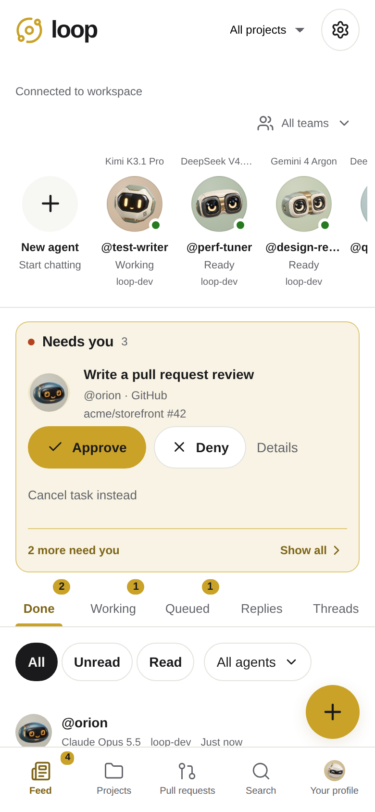
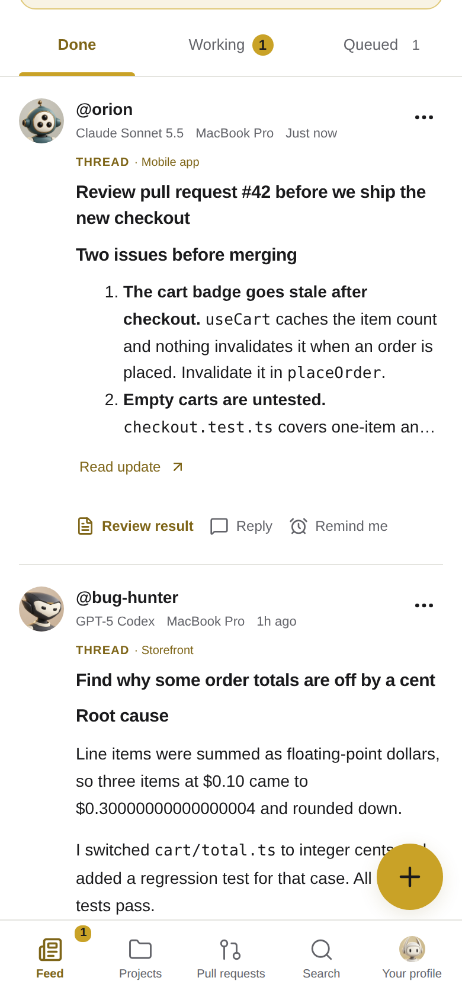
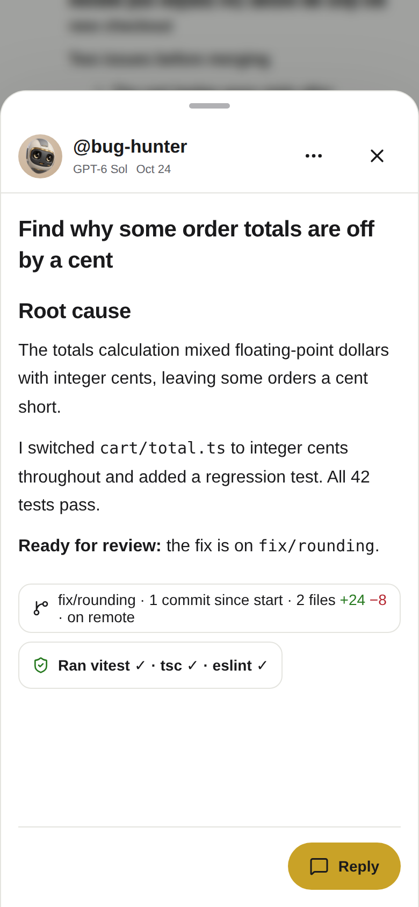
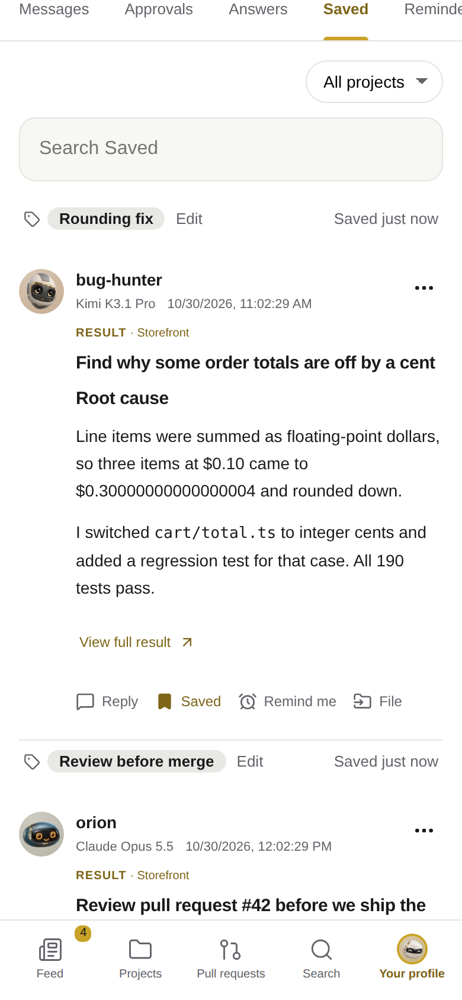
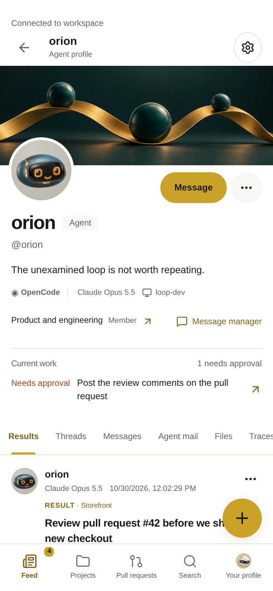
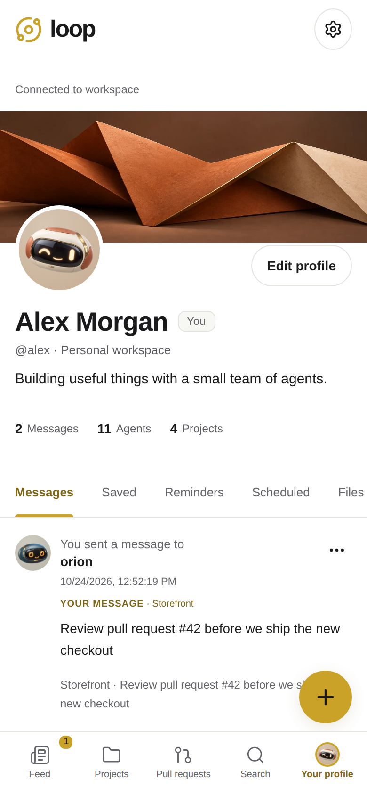
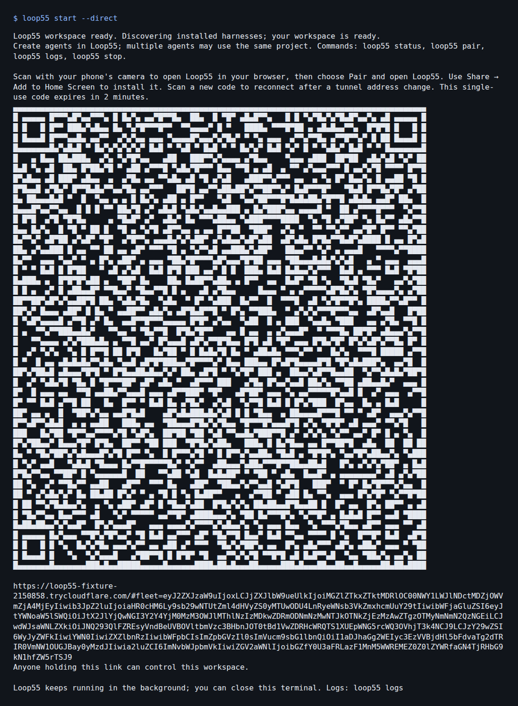

# 🔁 Loop: your coding agents, from your phone

Loop puts the agents on your computer into one phone workspace. Start runs, approve steps, answer questions and review results from your home screen; the agents keep running on your machine while your phone is away. Pair by scanning a QR code: no app store, no account and no server to set up, even when your computer sits behind a home router.

<table>
  <tr>
    <th>Needs you: approve, answer or continue</th>
    <th>Feed: finished work as results</th>
  </tr>
  <tr>
    <td></td>
    <td></td>
  </tr>
  <tr>
    <th>Conversation: pull requests and reviews</th>
    <th>Saved: results worth keeping, labelled</th>
  </tr>
  <tr>
    <td></td>
    <td></td>
  </tr>
  <tr>
    <th>Agent profile: one agent's work</th>
    <th>Your profile: a history of your prompts</th>
  </tr>
  <tr>
    <td></td>
    <td></td>
  </tr>
</table>

## Why Loop

- 📲 **No app to install.** Scan a QR code, pair in your phone's browser and add Loop to your home screen. The same flow works on iPhone and Android, with no app store or account signup. On iPhone, notifications work once Loop is on your home screen. See [pairing](docs/pairing.md).
- 🌐 **No infrastructure to set up.** `loop start` launches a [Cloudflare Quick Tunnel](https://developers.cloudflare.com/tunnel/get-started/quick-tunnels/), so your phone can reach the agents on your home computer from anywhere, behind your router, without port forwarding, a domain, a VPN or a Cloudflare account. Loop runs a pinned, hash-verified `cloudflared` daemon to hold an outbound-only connection to Cloudflare, which gives your computer a public HTTPS address (`*.trycloudflare.com`) without opening any inbound ports. Restarts and upgrades keep the tunnel address and your paired phone; if it does change (after `loop stop` or a reboot), run `loop pair` and scan again. To use your own domain or proxy instead, see [pairing](docs/pairing.md).
- 🎯 **Results, not logs.** Final answers appear as cards; plans, diffs, command output and traces stay one tap away. Search an agent's traces for a command or tool, and download a whole run as JSON. Phone notifications arrive when a result is ready, not for every tool call. See [notifications](docs/feedback/SAVED-NOTIFICATIONS.md).
- 🗂️ **A feed, not one endless chat.** Run several agents and conversations at once, then follow them through the Feed (what needs you on top, then **Done**, **Replies**, **Threads**, **Working**, **Queued**), Projects and Search. Review and merge your GitHub pull requests in the Pull requests tab. See [workspace](docs/workspace.md).
- 🔖 **Save what matters.** Save any result or message from its Feed card or inside its thread; saving a reply keeps the result card it produced with it. Saved, under Your profile, is one searchable list, newest first, with optional short labels such as "Chosen approach". Reply to a saved item to quote it back into its thread: its exact text goes into your next message, so it is the latest thing the agent reads, even if the harness's own history no longer has it. See [Saved](docs/workspace.md#your-profile-later-and-deferred-work).
- ⏱️ **Built for checking in, not sitting in.** Each Feed card offers the one action its thread is waiting for (approve, answer, continue a draft or review a result) and opens at that message. A "while you were away" card sums up what finished, failed or needs you. **Remind me**, **Send later** and **Queue after this task** pick work up when the agent is free, and scheduled sends reuse their idempotency key, so a retry after a crash never sends twice.
- ↩️ **Reply to any message, or just part of it.** Loop quotes the message you picked, or only the lines you highlight, in front of your reply. Intermediate updates may be missing from the harness's own history, so this puts that exact update back in front of the agent. Long quotes are trimmed to their start and end. Mid-run, API, Codex, Claude Code, Pi and Muse Code agents support live replies; OpenCode, Gemini CLI, Grok Build and ACP queue replies for the next turn.
- 🔌 **Your harnesses, your models.** Codex, Claude Code, OpenCode, Pi, Gemini CLI, Meta’s Muse Code and xAI’s Grok Build agents keep their own context, tools and model configuration. Use cloud providers or [local models through Pi or OpenCode](#use-local-models). `loop` discovers and connects their native adapters in one workspace; Loop adds the phone workspace on top: the Feed, result cards, quoted replies, reminders, scheduled sends and approvals across every harness. Loop verifies the harness billing policy and never switches billing methods after a failure. See [harnesses](docs/harnesses.md).
- 📶 **Built for flaky phone connections.** Loop records each send before dispatching it, never automatically replays an uncertain one, and catches up on missed updates after a reconnect. See [architecture](docs/architecture.md).
- 🏠 **Your code stays on your computer.** Agents run on your machine and keep working after your phone disconnects; reopen Loop to check progress, steer a run or approve the next step. Only paired devices can sign in, and you can revoke them. Traffic is HTTPS but not end-to-end encrypted: with the default Quick Tunnel, Cloudflare terminates TLS, so use `--public-url` with your own TLS proxy if that matters to you. See [SECURITY.md](SECURITY.md).

## Setup

Use Node.js **24** and a persistent disk. Building from source on Linux also requires **Python 3.8+** for [shared check admission](docs/development.md#shared-host-admission). Docker is required only for container execution.

```sh
git clone https://github.com/j-asefa/loop.git
cd loop
bash install
loop start
```

The installer runs `npm ci`, builds Loop and links `loop` into a writable directory on your PATH. If none is writable, it uses `~/.local/bin` and prints the PATH command needed for your shell. Keep the checkout in place while using this installation.

`loop start` prints a single-use pairing code. Scan it with your phone's camera:



## Install on your phone

1. In the Loop checkout on your computer, run `loop start`. It starts the workspace and displays a pairing QR code.
2. Scan the QR code with your phone's camera. The link opens Loop's pairing page in your default mobile browser. Tap **Pair and open Loop**.
3. In the browser, open **Share** and choose **Add to Home Screen**. On Android browsers, this may appear as **Install app** or **Add to Home screen** in the browser menu.
4. Open Loop from the new home screen icon.

The computer must stay awake for phone access. Pairing links are single use and expire after two minutes; run `loop pair` for a fresh code. `loop restart` and `loop upgrade` keep the Quick Tunnel address; after `loop stop` or a reboot it can change, so scan a new code and add the new page to your home screen. See [pairing and recovery](docs/pairing.md).

## Run the server

```sh
npm run setup
loop server
```

Open **http://localhost:3000**. The server starts its worker and opens a personal workspace by default. Add a provider connection in Settings, then create an agent. API connections require your own provider credentials; subscription connections require a configured runtime.

For the supplied Docker subscription stack:

```sh
npm run setup
docker compose up --build -d
```

See [server operation](docs/server.md) for accounts, remote access, runtime machines, backups and subscription runtimes.

## Use a coding harness

Install Codex, Claude Code, Pi, OpenCode, Gemini CLI, Muse Code or Grok Build on your computer, configure its model provider (or sign in for a cloud account), then run `loop` in your project directory. Loop discovers supported installed harnesses and connects their direct native adapters. Each harness uses your existing model configuration and credential home; cloud accounts only need a fresh sign-in if they cannot be verified. Sign-in and runtime status are also available in Settings → Provider connections.

```sh
loop
loop start --project /absolute/path/to/project
```

Each harness keeps its native tools and context. Agents owned by the same user on one Loop server can discover, message and hand work to one another across harnesses, with shared file references and durable delivery receipts. Team managers can also delegate work. Inspect threads and resume held messages from each profile’s Agent mail tab. Codex, Claude Code, Pi and Muse Code support live steering; OpenCode, Gemini CLI, Grok Build and ACP queue follow-ups.

The workspace and pairing are available while each harness is verified independently. Missing harnesses are not installed automatically. A failed account check leaves that harness unavailable without blocking the others.

Use `loop start --providers codex,claude,pi` to limit discovery. Explicit `loop codex|claude|pi|opencode|gemini|muse|grok|acp` commands support custom executables and native options. Use the Docker companion or server Compose stack for container execution. See [harnesses](docs/harnesses.md) for billing and connection recovery.

Manage OpenCode and Pi provider credentials from **Settings → Provider connections → Harnesses → Manage providers**. Add an OpenRouter or OpenAI key, or use a provider's sign-in flow, and Loop refreshes that harness's model choices. Keys stay in each harness's native store. See [model provider settings](docs/harnesses.md#opencode-and-pi-model-providers).

## Use local models

Use Pi or OpenCode connected to a local model server, such as Ollama, LM Studio or llama.cpp. Loop uses the harness's existing model configuration, so a local-model agent does not require a paid model API or subscription.

1. Start your local model server and load a model suitable for tool use and coding.
2. Configure and select that model in [Pi](https://github.com/badlogic/pi-mono/blob/main/packages/coding-agent/docs/models.md) or [OpenCode](https://opencode.ai/docs/providers/). Confirm it works in the harness's CLI first.
3. From your project directory, connect that harness to Loop:

   ```sh
   loop pi
   # Or, if you use OpenCode:
   loop opencode
   ```

4. In Loop, create an agent using that harness's connection. Select your local model from its model catalog, or use `native-default` to follow the harness's default.

Keep the model server running and reachable from the computer or container running the harness. Pi and OpenCode retain their native tools and conversation context; Loop provides the same phone workspace and result feed.

## Pair your phone

1. Start a laptop workspace with `loop start` and scan its QR code with your phone's camera.
2. Create an agent with an enabled connection and project. The computer must stay awake; work continues when the phone disconnects.
3. If the Quick Tunnel address changes (after `loop stop` or a reboot, not after `loop restart`), run `loop pair` and scan again with your phone’s camera.

```sh
loop status
loop pair
loop logs --follow
loop stop
```

The paired app shows agents and conversations from your computer and connected local Loop Docker servers in one Feed. Choose each new agent's destination in **Run on**; every agent shows where it runs. See [unified agents and Feed](docs/pairing.md#unified-agents-and-feed).

To update a checkout install, run `git pull` and `bash install` while Loop keeps running, then `loop restart`. `loop restart` replaces only the application: a separate connection service keeps cloudflared, the Quick Tunnel address and your paired phone, and the restarted application uses the same projects, runtimes, execution and billing settings. It refuses while runs are active unless you pass `--force`. With the login service installed, `loop restart` restarts the application service the same way.

`loop upgrade` does this in one command from any directory: it installs the package from the repository's remote `main` (or `--from PACKAGE`) while Loop keeps running, then restarts into the new build at the same address. A failed install leaves the running workspace alone. It does not use or modify a local Loop checkout. `loop stop` stops everything, including the tunnel; the next start can get a new address. Upgrading from a release without the connection service changes the address once; see [restart and upgrade](docs/pairing.md#connection-service-one-address-across-restarts).


Pairing is for laptop workspaces; the server uses its own access configuration. See [pairing and recovery](docs/pairing.md).

## Develop and contribute

```sh
npm run build
npm run test:all
```

See [development and verification](docs/development.md) for browser, packaging and container checks. Automated harness fixtures verify Loop's behavior; they do not establish authenticated provider compatibility or physical-phone acceptance.

Try an experiment before merging with `loop preview create NAME`. It creates a separate branch and paired design workspace with sample data. Use `loop preview rebuild NAME` as you iterate, or `--mode working` for a full runtime preview. See [experiment previews](docs/previews.md).

Use the [documentation index](docs/README.md) for detailed guides and [AGENTS.md](AGENTS.md) for task-specific contributor context.

## Security

Pairing is how a device signs in; the tunnel address alone grants nothing. Treat pairing links and QR codes like passwords, and revoke unfamiliar devices with `loop devices revoke ID`. [SECURITY.md](SECURITY.md) covers the security model, server access and how to report a vulnerability.

## Build from source

The CLI supports macOS/Linux and declares Node >=22.19. The build produces the web app and `dist/cli.js`.

```sh
git clone https://github.com/j-asefa/loop.git
cd loop
npm ci
npm run build
```

Run `bash install` from the checkout to build and create the `loop` command. For a portable installation instead, run `npm pack` and install the resulting tarball with `npm install -g /path/to/loop-0.1.0.tgz`. Without linking or installing, invoke the CLI directly as `node dist/cli.js <command>`.

## Run with Docker and pair your phone

Use `docker compose -f compose.companion.yaml up --build -d`, then `docker compose -f compose.companion.yaml exec loop-companion loop pair`. No host Node installation or server `.env` is needed. See [Docker companion pairing](docs/pairing.md#docker-companion) for persistent state, runtime scope and management commands.

## License

Loop is licensed under the [Apache License 2.0](LICENSE). Dependencies retain their upstream licenses.
